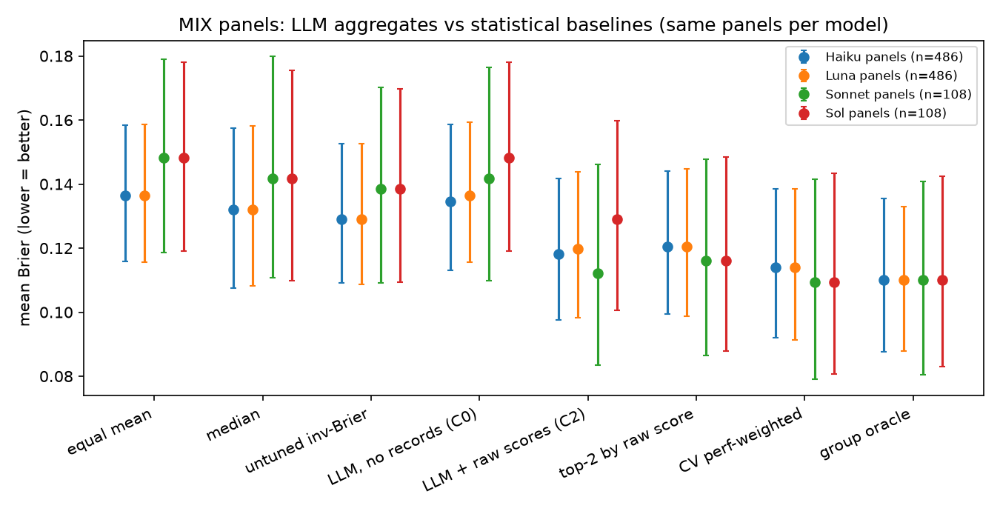
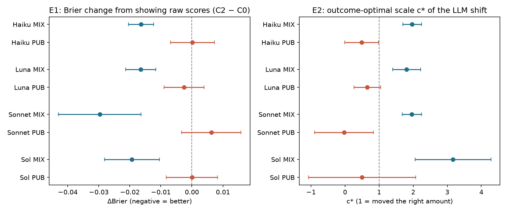
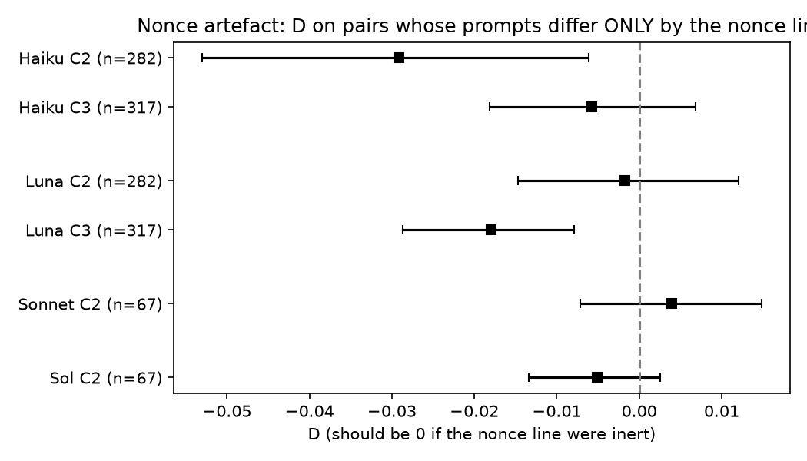

# Phase 3 Results (design v2, full run)

**Status:** the run completed on 2026-11-13, and the frozen analysis was run without change.
- **Independent review:** `docs/reviews/phase3_fable_review.md`, verdict **READY WITH LIMITATIONS**, no blockers.
  §9 records how each of its findings was handled.
- **Labels:** numbers marked [L] are the lead's independent recomputations (`results/lead_recompute/`). Numbers
  marked [R] are the reviewer's (`results/review_phase3/`). Unmarked numbers come from the frozen analysis
  (`results/phase3/live/analysis/estimands.csv`).
- This is a results record, not the paper.

---

## 0. Plain-language summary

**The setup.** An AI model sees five people's probability forecasts for the same question and gives one combined
forecast. We compare what happens when the model is also shown each person's **track record**: how accurate their
other forecasts were.

**What we score.** Accuracy is measured with the **Brier score**: the squared gap between the forecast and what
happened (0 or 1). Lower is better.

**Two kinds of panel:**
- **MIX:** three members of the public and two superforecasters. Track records *could* help here, because they
  let you find the experts.
- **PUB:** five members of the public. Records carry much less useful signal here.

**What we found:**
1. **Records help on MIX panels, for all four models tested.**
   - Showing one accuracy number per person lowered the Brier score by about 0.016 across all panels, or 0.019–0.030
     on the 108 panels that all four models share.
   - That is roughly half to three-quarters of the gain from knowing for certain who the superforecasters are.
   - On PUB panels, records made no measurable difference.
2. **But the models are not better than simple maths.** With records, every model beats a plain average. None beats
   a simple statistical rule that weights people by past accuracy, and two of the four models do worse than it.
3. **On MIX panels the models move toward the experts too little.** Doubling the shift each model makes after
   seeing the records would improve its forecasts further, and this holds on questions held out of the fit. On
   PUB panels, the shifts add no demonstrable accuracy.
   - The models respond to the scores about equally on both panel types. They are not told that experts might be
     present, so "too little" means "less than an aggregator that knows the panel contains experts".
4. **Reputation farming:**
   - Padding a record with easy, confident forecasts inflates a raw accuracy score slightly. Peer-relative and
     difficulty-adjusted scores remove that inflation. This result needs no AI.
   - Our test of whether the models *discount* a farmed record cannot be interpreted. A bookkeeping line we added
     to the comparison prompts changed one model's behaviour (§6).
   - Even without that problem, the test was too weak to detect the small discount that would be justified, and
     the data suggest no discount is warranted at all.

---

## 1. What was run

| Item | Value | Source |
|---|---|---|
| Design | v2, frozen before any Phase 3 call | `docs/EXPERIMENT_DESIGN.md` §10, `configs/phase3_design.yaml` |
| Data | ForecastBench human round 2024-07-21 (pinned `203a0d1`), 162 questions | `configs/data_manifest.yaml` |
| Panels | 972 frozen panels: 162 q × 3 draws × {MIX, PUB} | `results/phase3/build/panels.json` |
| Efficient tier | Haiku (`anthropic/claude-haiku-5.5`) and Luna (`openai/gpt-6-luna`): 486 panels per type, all arms, 8,354 requests each | `results/phase3/build/manifest_efficient_*.jsonl` |
| Strong tier | Sonnet (`anthropic/claude-sonnet-5.5`) and Sol (`openai/gpt-6.1-sol`): nested 108-question subset at draw 0, no C3 farming or swap arms, 1,584 requests each | `results/phase3/build/manifest_strong_*.jsonl` |
| Responses | 19,876 unique rows, matching the manifests 1:1 [R]; 0 parse failures; 0 truncation retries; all `finish_reason = stop` [R] | `results/phase3/live/<model>/responses.jsonl.gz` |
| Integrity | 162/162 outcomes match the raw resolution file; 0 of 39,745 displayed records contain the target id; no pilot cache replay [R] | `results/review_phase3/01_integrity.out`, `07_misc.out` |
| Cost | $11.2153 (harness ledger), identical to the OpenRouter key-usage delta of $11.2153 [L] | `results/phase3/spend.jsonl` |

**Conditions** (what the model sees beside the five forecasts):

| Code | Records shown |
|---|---|
| C0 | No records |
| C1 | Itemised records: 8 past questions, each with forecast, outcome and score |
| C2 | One raw mean Brier score per person (3 decimals) |
| C3 | One peer-relative score per person |

Secondary arms:
- **`_swap`:** records shuffled among the members.
- **`_farmed`:** the attacker's record is replaced with confident, easy items.
- **`_control`:** a score-matched uniform record for the same attacker.
- **`C2_retest`:** a repeat of C2.
- **`probe`:** shows the question text and no forecasts.

**Samples:**
- **primary:** every panel a model ran.
- **exclude_pilot:** drops the 16 pilot questions.
- **common_draw0:** 108 questions × draw 0, shared by all four models.

The tiers' primary samples differ, so **cross-model comparisons use `common_draw0` only** (§5).

---

## 2. Confirmatory family (per model; Holm over 4 tests; frozen two-way CGM SEs)

Primary sample. Each cell gives the estimate, its 95% CI and the Holm-adjusted p.

| Model | E1: MIX ΔBrier C2−C0 | E2: c\*_C2 MIX (H0 = 1) | E2: c\*_C2 PUB (H0 = 1) | E3b: D_C1, one-sided < 0 |
|---|---|---|---|---|
| Haiku | −0.0164 [−0.0205, −0.0123], p<1e-4 | 1.97 [1.69, 2.25], p<1e-4 | 0.49 [−0.01, 0.99], 0.089 | +0.0083 [−0.013, 0.030], 0.78 |
| Luna | −0.0165 [−0.0214, −0.0117], p<1e-4 | 1.81 [1.40, 2.22], 0.0004 | 0.65 [0.26, 1.05], 0.17 | −0.0054 [−0.026, 0.015], 0.30 |
| Sonnet | −0.0297 [−0.0430, −0.0164], p<1e-4 | 1.96 [1.67, 2.25], p<1e-4 | −0.03 [−0.89, 0.83], 0.039 | −0.0020 [−0.028, 0.024], 0.44 |
| Sol | −0.0193 [−0.0282, −0.0105], 0.0001 | 3.17 [2.06, 4.28], 0.0004 | 0.50 [−1.08, 2.07], 0.53 | −0.0074 [−0.020, 0.005], 0.26 |

**Reproduction:**
- Every confirmatory estimate, SE and p-value was reproduced by independent code, to within 8.9e-16 over 164 rows
  [R].
- The 48 headline E1 and c\* point estimates were also reproduced, to within 4.4e-16 [L].

**Robustness:**
- **E1 MIX and c\* MIX:** both stay Holm-significant for every model in `exclude_pilot` and `common_draw0`, and
  under every SE convention tried [R]:
  - frozen two-way CGM;
  - CGM counting each panel pair once;
  - question-only clustering;
  - question jackknife.
- **SE sensitivity, c\* PUB for Sonnet:** this is the **only** cell whose conclusion depends on the SE convention.
  - Frozen CGM: SE 0.44, Holm 0.039.
  - Exact-pair CGM: Holm 0.060.
  - Question-clustered: SE 0.56, Holm 0.13.
  - Jackknife: Holm 0.17 [R] (`07_conservative_holm.csv`).
  - The frozen two-way SE can fall below the one-way SE because the cross-forecaster terms are negative, and it
    has no small-sample correction.
  - **We therefore do not treat Sonnet's PUB result as a finding.**

### RQ1 (utility): records help in MIX, by less than a simple statistical rule; null in PUB
- **MIX:** showing raw scores lowers the Brier score for all four models, so the "all models" criterion is met.
- **Comparable magnitudes:**
  - Three-draw efficient tier: −0.016 (Haiku and Luna).
  - Common 108 × draw-0 sample: Haiku −0.027, Luna −0.027, Sonnet −0.030, Sol −0.019.
  - Draw 0 happens to have the largest expert advantage (mean-minus-oracle Brier 0.038, against 0.014 and 0.027
    for draws 1 and 2 [R]). The common-sample magnitudes are therefore favourable, and the tiers' primary numbers
    must not be compared.
- **Oracle-gain fraction (C2 MIX, descriptive):** Haiku 0.62, Luna 0.63, Sonnet 0.78, Sol 0.51. The oracle here is
  the plain mean of the two superforecasters' forecasts.
- **PUB:** ΔBrier is 0.000, −0.003, +0.006 and 0.000, and every CI includes 0.
- **Format:**
  - C1 (itemised) helps Luna and Sol about as much as C2, but not Haiku (oracle fraction −0.16 [−0.36, 0.05]) and
    barely Sonnet (0.13).
  - C3 (peer-relative) helps less than C2 for every model (0.23–0.45).
- **Supported conclusion:** when a panel contains identifiable experts, one accuracy number per forecaster lets each
  tested LLM capture roughly half to three-quarters of the oracle gain. That is less than a simple
  cross-validated weighting rule achieves (§3). With all-public panels there is no gain.

### RQ2 (calibration of reliance): MIX under-reaction, narrowly read; PUB adds no demonstrable accuracy
- **Definition:** c\* is the scale *k* that minimises the Brier score of p_C0 + *k*·(p_C2 − p_C0). It is W-free.

**MIX: c\* 1.8–3.2, CIs exclude 1 for every model.** Robust to every check run [L, R]:
- **Cross-fitting:** fitted on other questions, rescaling improves held-out Brier [L]:
  - Haiku −0.0059 [−0.0095, −0.0022]
  - Luna −0.0049 [−0.0085, −0.0011]
  - Sonnet −0.0123 [−0.0187, −0.0065]
  - Sol −0.0233 [−0.0341, −0.0125]
- **Other checks:**
  - the question jackknife;
  - dropping the 5 highest-leverage questions (2.02, 1.81, 2.79, 4.04);
  - measuring the shift from the equal mean [R].
- **Swap check:** with swapped records, c\* turns negative, so the useful shift is driven by the records and is not
  generic extremising [R].

**How to read it.** Three qualifications apply (reviewer MAJOR 4):
1. **It is the same fact as E1, not an independent finding.** The models move 30–44% of the way from the mean to
   the superforecasters' mean [R]. Under quadratic loss, that both captures 51–78% of the gain and implies c\* ≈ 2
   or more.
2. **The policy is regime-blind.** The models' slope on displayed-score differences is similar in MIX and PUB,
   and slightly higher in PUB [R] (`08_regime_blind_policy.csv`):

   | Model | MIX slope | PUB slope |
   |---|---|---|
   | Haiku | 2.3 | 2.6 |
   | Luna | 2.7 | 3.3 |
   | Sonnet | 2.5 | 2.7 |
   | Sol | 2.0 | 2.2 |

   The spread of displayed scores is also similar (0.093 vs 0.090). The prompt does not say whether experts are
   present, so "under-reliance" means **less than an aggregator that knows this panel contains experts**. It does
   not mean the model fails to read the scores.
3. **"About double" is an in-sample magnitude.**
   - Even the CV-tuned W has an outcome-optimal scale of 1.28 (486 panels) or 1.71 (108 panels). Part of c\* > 1
     reflects this sample favouring experts more than cross-validation predicted.
   - At c\*, 14–18% of rescaled MIX forecasts would leave [0, 1] [R].
   - The ex-ante statement is that the LLMs move 0.42–0.65 as far as the CV-tuned W (β_base, secondary).

**PUB: c\* is below 1 for all four models, but this is not evidence of over-reliance** (reviewer MAJOR 3):
- Only Sonnet passes Holm, and only under one SE convention (above).
- Sonnet's value comes from its *no-record* answer, not from its use of records. Its C0 leans toward the median
  and beats the mean by 0.012 in PUB. Measured from the equal mean, its c\* is 0.79 (SE 0.37) [R].
- **c\* is attenuated by noise.** c\* is a through-origin regression, so sampling noise in p_C2 inflates the
  denominator. With no record effect and equal noise in both calls, its expected value is 0.5, not 1. H0 c\* = 1
  is therefore not the null of "no over-reliance". The noise-corrected PUB c\* is 0.47–0.71 (Haiku) and
  0.69–0.72 (Luna) [R].
- Cross-fitted rescaling gives no held-out gain in PUB for any model [L, R], and E1 PUB is null.
- **Supported:** in PUB, record-induced shifts add no demonstrable accuracy.
- **Not supported:** "the models over-react in PUB", and any Sonnet-specific claim.

**MIX − PUB contrast (directly supported; reviewer's test, two-way clustered stacked influence functions)** [R]
(`results/review_phase3/04_direct.csv`). Question-bootstrap CIs exclude 0 for every model.

| Model | Difference in c\* (MIX − PUB) | z |
|---|---|---|
| Haiku | 1.48 | 5.7 |
| Luna | 1.15 | 4.5 |
| Sonnet | 1.99 | 3.2 |
| Sol | 2.67 | 2.6 |

**β against W (secondary):**
- β_base for C2 MIX is 0.42–0.65, against W's own β\* of 1.28 or 1.71.
- The untuned inverse-Brier benchmark gives β_base > 1. Its scale depends on the benchmark and is not
  interpreted.

### RQ3 (gaming)
**RQ3a (data level, no LLM; confirmatory).** Source: `results/phase3/e3a/`; 4,283 attacker-target pairs;
two-way CGM.
- **Inflation:**
  - raw +0.0179 [0.0097, 0.0260];
  - peer −0.0056 [−0.0118, 0.0007];
  - FE −0.0060 [−0.0121, 0.0001].
- **Supported:** farming inflates raw scores modestly, and peer or difficulty adjustment removes it.
- **Heterogeneity** [R]:
  - Raw inflation is +0.048, +0.031 and −0.023 across skill terciles, and positive for 62% of attackers.
  - For weak forecasters, farming *deflates* the score.
  - The FE abilities used for E3a were fitted on data that include the target. This affects the E3a FE row only.

**Normative check: no discount is warranted.**
- Does a farmed raw score predict target accuracy worse than a uniform one? The frozen single-draw result is
  +0.005 [−0.023, 0.033].
- Averaged over 20 record draws, the farmed score correlates slightly *better*: mean difference +0.019, range
  −0.004 to +0.043 [R] (`08_normative_seeds.csv`).
- At an equal displayed score, a farmed record implies a target Brier only about 0.003 worse [R].

**RQ3b (LLM discount, D_C1): not identified, and uninformative even if it had been.**
- **Not identified:** the control arm carries a nonce line that changes model behaviour (§6).
- **Uninformative even without the nonce** (reviewer MAJOR 2):
  - Since no discount is warranted, D ≈ 0 is also the rational response. A null cannot separate "ignores
    composition" from "correctly ignores composition".
  - A model that fully undid the mean inflation would produce D of only about 0.003–0.015, below every model's
    minimum detectable effect (0.016–0.033 at 80% power) [R].
  - Haiku and Sonnet barely respond to itemised scores (pull per unit score in C1 0.25 and 0.18, against 0.94 and
    0.99 in C2) [R].
  - C1 records show outcomes by category code, so farmed and control records carry different base-rate
    information. Score matching does not remove this confound.
- **D_C1 point estimates** are +0.008, −0.005, −0.002 and −0.007. They are reported for completeness and support
  no conclusion either way.

---

## 3. Comparison with simple and statistical baselines
- **Source:** [L] `results/lead_recompute/baseline_brier.csv`; independently [R] `results/review_phase3/03_baselines.csv`,
  which agrees.
- **Values:** paired differences (LLM C2 Brier − baseline Brier) on each model's own panels, with question-cluster
  bootstrap 95% CIs.
- **Reading the table:** negative means the LLM is better. **Bold** marks a CI that excludes 0.
- **Baseline definitions:**
  - **CV perf-weighted (W):** its weighting hyperparameters are tuned on other questions' outcomes (5-fold by
    question).
  - **Top-2:** averages the two members with the best displayed raw scores. No parameter is tuned.
  - **Untuned inverse-Brier:** uses no outcomes.
  - **Group oracle:** the plain mean of the two superforecasters.

**MIX panels**

| LLM C2 minus… | Haiku | Luna | Sonnet | Sol |
|---|---|---|---|---|
| equal mean | **−0.018** | **−0.017** | **−0.036** | **−0.019** |
| median | **−0.014** | **−0.012** | **−0.030** | **−0.013** |
| untuned inverse-Brier | **−0.011** | **−0.009** | **−0.027** | **−0.010** |
| same LLM, no records (C0) | **−0.016** | **−0.017** | **−0.030** | **−0.019** |
| top-2 by raw score | −0.002 | −0.001 | −0.004 | **+0.013** |
| CV perf-weighted W (raw) | +0.004 | **+0.006** | +0.003 | **+0.020** |
| group oracle | **+0.008** | **+0.010** | +0.002 | **+0.019** |

On the common sample, Haiku is also significantly worse than W: +0.011 (SE 0.004) [R].

**PUB panels:**
- No predictor beats the equal mean: neither the LLMs nor W (0.1695 vs 0.1689).
- The LLM C2 differences from the mean, median, untuned rule and C0 all have CIs that include 0.
- The LLMs do beat the rules that over-react to noisy PUB records:
  - top-2, by about 0.008 (Haiku and Luna);
  - CV perf-weighted-adj, by about 0.010 (Haiku and Luna);
  - CV perf-weighted-raw, by 0.011 (Sonnet).

**C1 and C3:** in MIX, LLM C3 is worse than W on peer scores for Haiku, Luna and Sol [R].

**Supported reading:** records help an LLM when a simple statistical rule would also help, and they help it
**less** than that rule. Every "records help" statement should carry this comparison and the PUB null.



*The marginal Brier CIs overlap heavily because questions differ greatly in difficulty. Inference rests on the
paired differences in the table, not on the overlap of these bars.*



---

## 4. Secondary and exploratory outputs (no multiplicity control)

| Output | Result | Source |
|---|---|---|
| Swap manipulation check (β_swap against W) | C2: 0.42–0.60 (MIX), 0.53–0.84 (PUB), all CIs well above 0. C3 is weaker: Haiku 0.12–0.18, Luna 0.38–0.49 | `estimands.csv` |
| Swap sign (share of swaps moving in the right direction) | C2: 95–100%. C3 Haiku: 69–73%, with 20–24% zero shifts | [R] `07_swap_sign.csv` |
| Retest SD per forecast | Haiku 0.042, Luna 0.027, Sonnet 0.010, Sol 0.010. **Upper bound on sampling noise** (the retest arm carries its own nonce) | [R]; for the SD of differences (×√2), see [L] `nonce_summary.csv` |
| Probe (question text, no forecasts) | Brier: Haiku 0.146, Luna 0.133, Sonnet 0.120, Sol 0.134, against crowd 0.140–0.144 and base rate about 0.21. Pretraining knowledge of the questions is plausible, so anonymisation of the main prompts is the only protection against it | [R] `07_probe.csv` |
| D sample sizes | 353 of 486 PUB panels (efficient) and 81 of 108 (strong) after the \|g\| ≥ 0.10 and match-validity filters | `estimands.csv` |
| D_C3 | Luna −0.0148 [−0.026, −0.004]. **Not a peer-score defence:** the whole signal sits in pairs whose prompts differ only by the nonce (§6) | `estimands.csv`, [L, R] |
| Reasoning | Sonnet emits no reasoning tokens at effort "low", so cross-model contrasts are confounded with reasoning. No request needed the 4,000-token retry | `retry_reasoning.csv` |

---

## 5. Cross-model and sample differences
- **Comparable samples.** The strong tier's primary sample is the 108 × draw-0 subset. Draw 0 is favourable to
  experts (§2), so primary numbers are not comparable across tiers.
- **On `common_draw0`:**

  | Model | E1 MIX | c\* MIX |
  |---|---|---|
  | Haiku | −0.027 | 2.40 |
  | Luna | −0.027 | 2.17 |
  | Sonnet | −0.030 | 1.96 |
  | Sol | −0.019 | 3.17 |

- **No model ranking is claimed.** The CIs overlap, and there is a reasoning confound.
- **Holm in `common_draw0`:** the code divides over 4 tests although D is not computed there (3 tests). This is
  conservative and changes no conclusion. It is left as frozen and disclosed.
- **Pilot exclusion:** every confirmatory direction and significance call is unchanged without the 16 pilot
  questions.

---

## 6. The nonce limitation (lead audit, confirmed independently by the reviewer)
**Sources:**
- [L] `results/lead_recompute/nonce_audit.py` → `nonce_pairs.csv`, `nonce_summary.csv`; `provider_audit.py`.
- [R] `results/review_phase3/05_nonce_farming.py` and the `05_*.csv` outputs.
- Reasoning tokens per call: the frozen `retry_reasoning.csv`.

### 6.1 What happened
- The response cache is keyed on the prompt. In C2, the score-matched control often shows *exactly* the same
  3-decimal score as the farmed record.
- As a result, 373 of 486 C2_control prompts were byte-identical to C2_farmed and would have replayed the farmed
  answer.
- Before the run, we fixed this by appending `\nCache nonce: control` to the user message of **every** `*_control`
  request (commit 33c1a65). `C2_retest` already carried `\nCache nonce: retest`.
- **The flaw:** the fix made the prompt text depend on the condition.

**Arms that carry a nonce:**

| Arm | Models |
|---|---|
| C1_control | all four |
| C2_control | all four |
| C3_control | Haiku, Luna |
| C2_retest (`retest` nonce) | all four |

### 6.2 Established evidence (from identical-text pairs)
- **The natural experiment:** for 373 PUB panels (efficient tier) and 90 (strong tier), the C2_control and
  C2_farmed prompts are identical **except for the nonce line**. A systematic difference between them is
  therefore caused by the nonce line.
- **Inference:** question-cluster bootstrap CIs [L]. The reviewer's independent values agree [R].

| Model | Arm, identical pairs | Mean (control − farmed) | D contribution | Reasoning tok/call, farmed → control | Share of calls that reason, farmed → control [R] |
|---|---|---|---|---|---|
| Haiku | C2, n=373 | **−0.0124 [−0.019, −0.007]** | **−0.029 [−0.053, −0.006]** | 337 → 137 | 87% → 35% |
| Haiku | C3, n=417 | −0.0005 [−0.004, 0.003] | −0.006 [−0.018, 0.007] | 33 → 16 | |
| Luna | C2, n=373 | +0.0011 [−0.003, 0.005] | −0.002 [−0.015, 0.012] | 251 → 254 | 100% → 100% |
| Luna | C3, n=417 | **−0.0032 [−0.006, −0.000]** | **−0.018 [−0.029, −0.008]** | 223 → 225 | |
| Sonnet | C2, n=90 | **+0.0038 [0.001, 0.007]** | +0.004 [−0.007, 0.015] | 0 → 0 | 0% → 0% |
| Sol | C2, n=90 | +0.0005 [−0.002, 0.003] | −0.005 [−0.013, 0.003] | 82 → 83 | 98% → 99% |

**What this establishes:**
1. **Haiku:** the nonce line changes Haiku's answers, which move toward the equal mean. Its D contribution of
   −0.029 matches the failed D_C2 placebo (−0.034). The earlier claim is **verified**.
2. **Mechanism for Haiku:** any nonce line suppresses its reasoning.
   - Reasoning tokens per call fall from 258 to 81 in C1, 337 to 137 in C2 and 33 to 16 in C3. C2_retest drops to
     182, against 300 for C2.
   - The share of C1 calls that reason falls from 28% to 8% [R].
   - **This is not a routing artefact.** Provider shares are balanced across arms. Within same-provider identical
     pairs (n=130), the mean shift is −0.010, and the reasoning drop is 156–194 tokens on each of the three
     providers [L].
3. **Luna:** its D_C3 signal sits entirely in nonce-only pairs. Its retest answers also move toward the mean
   (−0.010, SE 0.003 in PUB) [R].
4. **Sonnet:** its C2 mean shift is nominally significant. With about 12 cells examined, one or two nominal hits
   are possible by chance.
   - So for Luna and Sonnet this is evidence *compatible* with a nonce effect, not proof of one.
   - For no model was the nonce line shown to be inert.

### 6.3 Suspected but not established
- **A nonce effect in C1, the confirmatory arm, for any model.** In C1, the farmed and control prompts also differ
  in their records, so the nonce effect cannot be separated from the treatment.
  - For Haiku, the drop in reasoning in C1_control makes a C1 effect likely.
  - For the others, the C2 placebo intervals admit nonce effects of 0.011–0.019 [R]. That is larger than every
    D_C1 point estimate and half to three-quarters of the MDE.
  - The effect also differs by condition within a model (Haiku: C2 −0.029, C3 −0.006; Luna: C2 −0.002,
    C3 −0.018), so C2 does not transfer to C1.
  - **A non-significant placebo in Luna, Sonnet or Sol is not proof that their nonce effect is absent.**

### 6.4 What is affected

| Estimand | Uses nonce arms? | Status |
|---|---|---|
| E1, oracle fraction | No (C0–C3) | **Unaffected** |
| c\*, cross-fitted c\*, MIX − PUB contrast | No | **Unaffected** |
| β_base, β\*, β_swap, swap sign | No (C0–C3, `_swap`) | **Unaffected** |
| Baselines (§3), probe | No | **Unaffected** |
| E3a, normative check | No LLM | **Unaffected** |
| D_C1 (confirmatory E3b) | Yes | **Not identified**; also uninformative (§2 RQ3b) |
| D_C2 (placebo) | Yes | Haiku's failure is explained by the nonce; the others are uninformative about C1 |
| D_C3 | Yes | Not interpretable |
| Retest SD | Yes (retest nonce) | Upper bound on sampling noise |

Code check: `src/ledger/analysis_v2.py` uses `_control` only on line 72, in the D block. The reviewer confirmed
this independently.

### 6.5 Decision: disclosure and restricted interpretation; no follow-up
- **Initial proposal:** a seeded follow-up. It would use identical prompt text in both arms, with cache-busting
  through a per-request `seed` in the generation settings, and cost about $1.2 for the efficient tier.
- **Decision: not run, and not recommended.**
  - The follow-up would remove the nonce, but not the three problems in reviewer MAJOR 2: no discount is
    warranted, the test is underpowered for the warranted effect, and the C1 base-rate confound remains.
  - Spending on it would buy precision on a question this design cannot answer.
  - This is not a choice to avoid an unwelcome result: every possible outcome of the follow-up would be
    uninterpretable for the same reasons.
- **What a future study would need:** an arm in which a discount *is* warranted, plus power computed against that
  warranted effect.
- **Lesson for the harness:** cache-busting belongs in the request settings, never in the prompt text
  (`docs/IMPLEMENTATION_NOTES.md`).



---

## 7. Other caveats
- **Cross-sectional ledgers.** Track records are reconstructed from the same round, not built in chronological
  order (`docs/DATA_AUDIT.md`). No displayed record contains the target question.
- **MIX framing.** MIX makes the task "find the two superforecasters", and the model is not told that experts
  might be present.
- **Scope.** One date, one platform, 162 questions.
- **Probe.** The models' knowledge of the questions from text alone is about crowd level. The main prompts hide
  the question text, so the result rests on that anonymisation.
- **Reasoning confound.** Sonnet does not reason, and Haiku's reasoning varies by provider and prompt.
- **Provider routing (unpinned).**
  - OpenRouter served each Anthropic model from three upstream providers: Haiku went to Azure 40%, Google 36% and
    Anthropic 25%, and Sonnet's split was similar.
  - Luna (one exception) and Sol went only to OpenAI.
  - Shares are balanced across conditions (within ±0.07 [L]), so routing adds noise but no detectable bias.
- **Provenance.**
  - Haiku's rows record commit `c0f6ca8`. The runner's `--concurrency/--limit` CLI flags were committed in
    `f48591a` only after that run had started.
  - That diff touches only CLI flags and the spend print-out; the request construction, cache and budget code are
    unchanged [R, L].
- **SE convention.** The frozen two-way CGM SE has no small-sample correction (§2 sensitivity).

## 8. Reproduction
**Commands** (no paid calls; the raw responses are committed gzipped):

```sh
for m in efficient_anthropic efficient_openai strong_anthropic strong_openai; do
  gunzip -k results/phase3/live/$m/responses.jsonl.gz; done      # restore raw responses
cp results/phase3/build/{panels.json,stat_predictions.csv,truth.csv,stat_hyperparameters.json} results/phase3/live/
uv run python scripts/analyze_phase3.py results/phase3/live       # frozen analysis -> results/phase3/live/analysis/
uv run python scripts/e3a_farming.py                               # RQ3a -> results/phase3/e3a/
uv run python results/lead_recompute/baselines.py                  # [L] baselines + headline reproduction check
uv run python results/lead_recompute/cstar_crossfit.py             # [L] hindsight check for c*
uv run python results/lead_recompute/nonce_audit.py                # [L] nonce audit
uv run python results/lead_recompute/provider_audit.py             # [L] provider routing (needs nonce_pairs.csv)
uv run python results/lead_recompute/figures.py                    # docs/figures/phase3_*.png
for s in results/review_phase3/0*.py; do uv run python $s; done    # [R] reviewer recomputation
uv run pytest -q
```

## 9. Independent review and responses
Review: `docs/reviews/phase3_fable_review.md`. Reviewer: Claude Fable 5.2 at High effort; read-only; no API calls.
**Verdict: READY WITH LIMITATIONS; no blockers.**

| ID | Severity | Finding | Response | Status |
|---|---|---|---|---|
| M1 | MAJOR | E3b not identified for any model (nonce). Luna's D_C3 is a nonce artefact. Placebos do not transfer from C2 to C1. | Independently confirmed by the lead audit (§6), including the provider check. D_C1 is reported as not identified; D_C3 is not presented as a defence. | Adopted |
| M2 | MAJOR | E3b would be uninformative anyway: no warranted discount, MDE above the warranted D, C1 base-rate confound. The follow-up is not recommended. | Adopted in §2 RQ3b. The proposed follow-up was withdrawn (§6.5). | Adopted |
| M3 | MAJOR | PUB c\* does not support over-reliance. Sonnet's Holm significance depends on the SE convention. Noise attenuates c\* toward 0.5. | The over-reliance and Sonnet claims were removed from the draft. The SE sensitivity was added. The direct MIX − PUB contrast is reported. | Adopted |
| M4 | MAJOR | MIX under-reliance is robust but is the same fact as E1, a regime-blind policy, and an in-sample magnitude. | All three qualifications were added to RQ2 and the summary. | Adopted |
| M5 | MAJOR | LLMs beat averaging but not the CV-tuned W. | Was already in the lead draft (§3). It is now paired with every "records help" claim, including the common-sample Haiku vs W result. | Adopted |
| M6 | MAJOR | Strong-tier magnitudes come from a favourable draw. | Magnitudes are quoted from the three-draw tier or from the common sample, and the draw-0 composition is stated. | Adopted |
| m1 | MINOR | Two-way SE below one-way; no small-sample correction. | SE sensitivity added (§2). Only Sonnet PUB changes. | Adopted |
| m2 | MINOR | Holm in `common_draw0` divides over 4 for a 3-test family. | Disclosed (§5). The frozen output is unchanged because the error is conservative. | Disclosed |
| m3 | MINOR | Retest SD, swap sign, probe and D sample sizes were omitted. | Added (§4). | Adopted |
| m4 | MINOR | The normative check rests on one record draw. | The 20-draw average is reported. The frozen single-draw value is kept and labelled. | Adopted |
| m5 | MINOR | E3a heterogeneity; FE fitted on data that include the target. | Added (§2 RQ3a). | Adopted |
| m6 | MINOR | Provenance: the commit was recorded before the runner flags were committed; three providers; §9 edited after the run. | Disclosed (§7). §9 edits are dated change-log entries, and §10 is unchanged. | Disclosed |
| m7 | MINOR | Draft text errors: the group oracle is a plain mean; W is 5-fold and top-2 is untuned; the run-to-run SD is of a difference. | Verified in code (`experiment_stats.py:36`, `baselines.py:31`) and corrected. | Corrected |

**Discovered bugs and corrections (all disclosed; no frozen output altered):**
1. **Cache nonce on control arms.** A design-implementation flaw that invalidates E3b (§6).
2. **Holm divisor in `common_draw0`.** Conservative.
3. **Lead draft text errors (m7).** Corrected before release.
4. **Unpinned provider routing.** A nuisance factor, disclosed.
